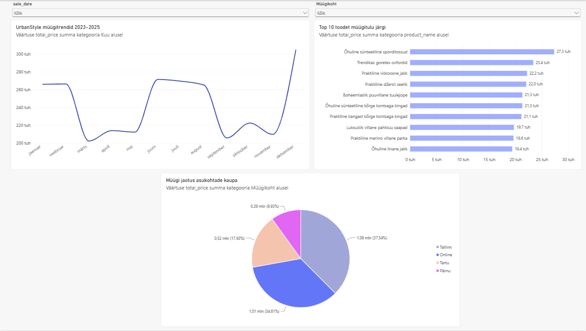

# Nädal 5 – Individuaalne töö

## Andmete visualiseerimine Power BI Desktopis

**DACA andmeanalüütiku programm | UrbanStyle**

---

## 1. Töö eesmärk

Viienda nädala individuaalse töö eesmärk oli õppida ühendama Power BI Desktopi PostgreSQL andmebaasiga ning koostama UrbanStyle'i müügiandmete põhjal interaktiivset aruannet.

Harjutasin andmete importimist, diagrammide loomist, DAX-i kasutamist ja interaktiivsete filtrite seadistamist.

## 2. Töökeskkond ja andmed

**Visualiseerimistööriist:** Power BI Desktop  
**Andmebaas:** Supabase PostgreSQL  
**Andmestik:** UrbanStyle

### Imporditud tabelid

| Tabel | Kirjeldus |
|---|---|
| `public sales` | Müügitehingud, kuupäevad ja müügisummad |
| `public customers` | Klientide andmed |
| `public products` | Tooted ja tootenimed |
| `public inventory` | Laoandmed |

## 3. Koostatud visualiseeringud

### 3.1. Müügitrendid ajas

**Diagramm:** joondiagramm  
**Pealkiri:** UrbanStyle müügitrendid 2023–2025

Kasutasin müügikuupäeva (`sale_date`) ja müügisumma (`total_price`) andmeid.

Diagramm võimaldab jälgida müügikäibe muutumist kuude lõikes.

### 3.2. Top 10 toodet müügitulu järgi

**Diagramm:** horisontaalne tulpdiagramm  
**Pealkiri:** Top 10 toodet müügitulu järgi

Kasutasin toodete nimetusi (`product_name`) ja müügisummat (`total_price`).

Seadistasin Top N filtri, et kuvada kümme suurima müügituluga toodet.

### 3.3. Müügi jaotus asukohtade kaupa

**Diagramm:** sektordiagramm  
**Pealkiri:** Müügi jaotus asukohtade kaupa

Kasutasin müügisummat ja müügikoha andmeid.

Lõin DAX-i abil arvutatud veeru `Müügikoht`, et kuvada puuduva asukohaga müügid veebimüügina.

```dax
Müügikoht =
IF(
    ISBLANK('public sales'[store_location]),
    "Online",
    'public sales'[store_location]
)
```

### Müügi osakaalud

| Müügikoht | Osakaal |
|---|---:|
| Tallinn | 37,54% |
| Online | 34,61% |
| Tartu | 17,93% |
| Pärnu | 9,93% |

*Osakaalud on ümardatud Power BI diagrammil kuvatud väärtused.*

## 4. Interaktiivsed filtrid

Lisasin aruandesse kaks filtrit ehk slicer'it:

1. **Kuupäev** – müügiperioodi valimiseks.
2. **Müügikoht** – asukoha või veebimüügi valimiseks.

Seadistasin mõlemad filtrid ripploendina.

Kontrollisin, et filtrite muutmine mõjutab kõiki kolme diagrammi.

## 5. Aruande kujundamine

Kohandasin diagrammide pealkirju, värve, suurusi ja paigutust.

Kasutasin heledaid pastelseid toone ning paigutasin filtrid aruande ülaossa.

Eesmärk oli muuta aruanne selgeks ja lihtsalt kasutatavaks.

## 6. Peamised tähelepanekud

1. **Tallinnas oli suurim müügikäibe osakaal** – ligikaudu 37,54%.
2. **Veebimüük moodustas olulise osa käibest** – ligikaudu 34,61%.
3. **Top 10 toodete diagramm** aitab võrrelda suurima müügituluga tooteid.
4. **Kuupäeva- ja müügikoha filtrid** võimaldavad analüüsida valitud perioodi või asukoha tulemusi.

## 7. Töö tulemus

Valmis kolme diagrammi ja kahe interaktiivse filtriga Power BI aruanne.

Aruanne on salvestatud failina `Urbanstyle.pbix`.

### Aruande ekraanipilt



## 8. Mida ma õppisin

Viiendal nädalal õppisin:

- ühendama Power BI Desktopi PostgreSQL andmebaasiga;
- importima andmetabeleid;
- koostama joondiagrammi, tulpdiagrammi ja sektordiagrammi;
- kasutama Top N filtrit;
- looma DAX-i abil arvutatud veergu;
- seadistama interaktiivseid filtreid;
- kontrollima diagrammide ristfiltreerimist;
- kujundama ja salvestama Power BI aruannet.

## 9. Kokkuvõte

Viienda nädala individuaalse töö käigus koostasin UrbanStyle'i müügiandmetest interaktiivse Power BI aruande.

Kõige olulisem õppetund oli see, kuidas ühendada andmebaasist pärinevad andmed visualiseeringutega ning muuta aruanne filtrite abil kasutajale interaktiivseks.

## 10. Kasutatud töövahendid

- Power BI Desktop
- Supabase
- PostgreSQL
- DAX
- GitHub
- Markdown

---

**DACA | Nädal 5 | Individuaalne töö**
